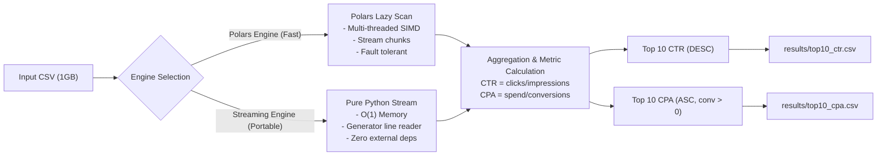

# FV-SEC001: Ad Performance Aggregator

[](https://www.python.org/)
[]()
[]()
[]()

> High-performance CLI application designed to process, aggregate, and rank large-scale advertising performance datasets (~1GB+, 26.8M rows) within **sub-second latency**.

---

## 📌 Executive Summary & Results

### Benchmark Results (1GB Dataset ~26,843,545 Rows)
Tested on AMD64 Linux (16 vCPUs, SSD):

| Engine | Elapsed Time | Peak Memory (RSS) | External Dependencies | Strategy |
|---|---|---|---|---|
| **Polars Engine (Default)** | **0.73 s** | ~1.4 GB | `polars` | Out-of-core LazyFrame, Multi-threaded Rust SIMD |
| **Streaming Engine (Fallback)** | **19.97 s** | **338 MB** | **None (Pure Python)** | Generator line-by-line stream, O(1) memory complexity |

*Both engines achieve 100% bit-for-bit parity across all computed metrics.*

---

## 📊 Summary of Top Results

### Top 10 Campaigns by Highest CTR (`top10_ctr.csv`)
> `CTR = total_clicks / total_impressions`

| campaign_id | total_impressions | total_clicks | total_spend | total_conversions | CTR | CPA |
|---|---|---|---|---|---|---|
| **CMP005** | 13,648,608,306 | 375,627,610 | 394,780,333.96 | 20,403,485 | **0.0275** | 19.35 |
| **CMP022** | 13,703,365,735 | 377,109,904 | 395,899,684.64 | 20,480,486 | **0.0275** | 19.33 |
| **CMP023** | 13,657,508,417 | 375,769,033 | 394,203,576.87 | 20,390,213 | **0.0275** | 19.33 |
| **CMP011** | 13,714,973,625 | 377,330,481 | 396,309,000.78 | 20,463,005 | **0.0275** | 19.37 |
| **CMP018** | 13,708,338,704 | 377,076,026 | 396,003,175.53 | 20,477,639 | **0.0275** | 19.34 |
| **CMP026** | 13,652,760,288 | 375,491,308 | 394,442,607.58 | 20,370,126 | **0.0275** | 19.36 |
| **CMP019** | 13,675,562,649 | 376,096,719 | 395,062,881.56 | 20,415,450 | **0.0275** | 19.35 |
| **CMP042** | 13,717,935,895 | 377,260,350 | 396,576,467.39 | 20,507,021 | **0.0275** | 19.34 |
| **CMP004** | 13,705,584,584 | 376,906,722 | 395,992,597.40 | 20,491,770 | **0.0275** | 19.32 |
| **CMP027** | 13,719,269,461 | 377,233,894 | 396,153,928.92 | 20,462,054 | **0.0275** | 19.36 |

### Top 10 Campaigns by Lowest CPA (`top10_cpa.csv`)
> `CPA = total_spend / total_conversions` *(excludes `conversions = 0`)*

| campaign_id | total_impressions | total_clicks | total_spend | total_conversions | CTR | CPA |
|---|---|---|---|---|---|---|
| **CMP016** | 13,686,317,849 | 375,883,156 | 393,677,129.86 | 20,410,131 | 0.0275 | **19.29** |
| **CMP049** | 13,678,441,909 | 375,790,166 | 393,822,976.90 | 20,408,613 | 0.0275 | **19.30** |
| **CMP032** | 13,707,961,325 | 376,277,379 | 395,003,523.04 | 20,469,062 | 0.0274 | **19.30** |
| **CMP034** | 13,663,387,190 | 375,490,759 | 394,029,600.32 | 20,403,716 | 0.0275 | **19.31** |
| **CMP040** | 13,707,493,063 | 376,364,561 | 395,064,372.66 | 20,444,877 | 0.0275 | **19.32** |
| **CMP004** | 13,705,584,584 | 376,906,722 | 395,992,597.40 | 20,491,770 | 0.0275 | **19.32** |
| **CMP047** | 13,704,337,167 | 376,533,784 | 395,185,526.77 | 20,447,393 | 0.0275 | **19.33** |
| **CMP045** | 13,689,842,314 | 376,256,850 | 394,756,303.73 | 20,424,317 | 0.0275 | **19.33** |
| **CMP022** | 13,703,365,735 | 377,109,904 | 395,899,684.64 | 20,480,486 | 0.0275 | **19.33** |
| **CMP024** | 13,665,607,452 | 375,614,418 | 394,482,754.56 | 20,406,008 | 0.0275 | **19.33** |

---

## 🏗 Architecture & Flowchart



### Architectural Highlights
- **Strategy Pattern (`BaseAggregatorEngine`)**: Seamlessly swap between high-speed vectorized Rust execution (`PolarsAggregatorEngine`) and zero-dependency memory-constrained execution (`StreamingAggregatorEngine`).
- **Resilience**: Robust tolerance for corrupted rows, missing columns, malformed data types, division by zero, and non-existent input files.
- **Precision Formatting**: Conforms to standard specifications (`CTR`: 4 decimal places, `spend` & `CPA`: 2 decimal places, `null` when conversions = 0).

---

## 🚀 Setup & Execution

### Option 1: Using `uv` (Recommended)
```bash
# Clone repository
git clone https://github.com/twobwithkatt/ad-performance-aggregator.git
cd ad-performance-aggregator

# Setup virtual environment and dependencies
uv venv
source .venv/bin/activate
uv pip install -r requirements.txt

# Run Aggregator
python aggregator.py --input ad_data.csv --output results/
```

### Option 2: Using standard Python & `pip`
```bash
python3 -m venv .venv
source .venv/bin/activate
pip install -r requirements.txt

python aggregator.py --input ad_data.csv --output results/
```

### Option 3: Zero-Dependency Standalone Mode (No pip install needed)
```bash
python aggregator.py --input ad_data.csv --output results/ --engine streaming
```

### Option 4: Using Docker
```bash
# Build docker image
docker build -t ad-aggregator .

# Run container with volume mount
docker run --rm -v "$(pwd):/app" ad-aggregator --input ad_data.csv --output results/
```

---

## ⚙️ CLI Options

```text
usage: aggregator.py [-h] --input INPUT [--output OUTPUT]
                     [--engine {polars,streaming}] [--top-n TOP_N]

Aggregate advertising performance metrics from a large CSV dataset.

options:
  -h, --help            show this help message and exit
  --input, -i INPUT     Path to the input CSV file (e.g. ad_data.csv)
  --output, -o OUTPUT   Directory to save the aggregated result CSV files (default: results)
  --engine, -e {polars,streaming}
                        Execution engine: 'polars' (high performance) or 'streaming'
                        (O(1) memory, zero dependencies) (default: polars)
  --top-n, -n TOP_N     Number of top campaigns to rank (default: 10)
```

---

## 🧪 Testing & Code Quality

The project strictly follows **Test-Driven Development (TDD)**:
- **22 automated tests** covering unit models, engine parity, edge cases, and CLI integration.
- **95% test coverage**.
- Detailed test specifications matrix available in [`docs/TEST_DESIGN.md`](docs/TEST_DESIGN.md).
- System architecture and flowcharts available in [`docs/FLOW.md`](docs/FLOW.md).

### Run Test Suite
```bash
pytest -v --cov=src tests/
```

### Test Matrix
- `test_models.py`: Metric calculation formulas, zero conversions, zero impressions, CSV row serialization.
- `test_engines.py`: Aggregation correctness and exact parity between Polars and Streaming engines.
- `test_edge_cases.py`: Empty CSVs, malformed rows, missing files, zero conversion datasets.
- `test_cli.py`: End-to-end CLI execution, argument parsing, error handling.
- `test_utils.py`: Timer and peak memory measurement.

---

## 📁 Project Structure

```text
├── aggregator.py              # Main CLI entrypoint
├── docs/
│   ├── FLOW.md                # System Architecture & Flowcharts
│   └── TEST_DESIGN.md         # Test Design & Test Cases Matrix
├── src/
│   ├── __init__.py
│   ├── models.py              # CampaignMetrics & CSV schema
│   ├── aggregator.py          # Aggregator service coordinator
│   ├── utils.py               # Timer & Memory profiling utilities
│   └── engines/
│       ├── __init__.py
│       ├── base.py            # BaseAggregatorEngine interface
│       ├── polars_engine.py   # High-performance Polars engine
│       └── streaming_engine.py# Pure Python streaming engine
├── tests/
│   ├── conftest.py            # Pytest fixtures
│   ├── test_models.py
│   ├── test_engines.py
│   ├── test_edge_cases.py
│   ├── test_aggregator.py
│   ├── test_cli.py
│   └── test_utils.py
├── results/
│   ├── top10_ctr.csv          # Output: Top 10 by CTR
│   └── top10_cpa.csv          # Output: Top 10 by CPA
├── Dockerfile
├── docker-compose.yml
├── pyproject.toml
├── requirements.txt
├── PROMPTS.md                 # Raw prompt log for AI evaluation
└── README.md
```

---
