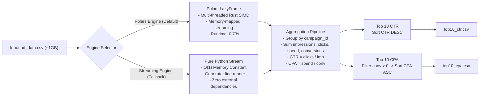
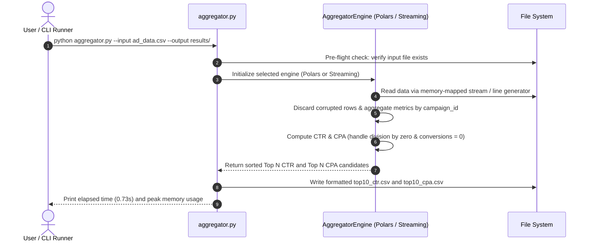

# System Architecture & Flowchart — FV-SEC001

This document outlines the detailed requirements breakdown, system architecture, and execution workflows for the **Ad Performance Aggregator**.

---

## 1. Requirements Breakdown & Specifications (Chi Tiết Yêu Cầu)

### 1.1 Input Dataset Analysis
- **Source File**: `ad_data.csv` (~1.04 GB, 26,843,545 records).
- **Schema**:
  | Column Name | Data Type | Description | Constraints / Notes |
  |---|---|---|---|
  | `campaign_id` | String | Unique campaign identifier | e.g. `CMP001`, `CMP042` |
  | `date` | String (`YYYY-MM-DD`) | Event log date | Valid date format |
  | `impressions` | Integer | Total ad impressions | Non-negative integer |
  | `clicks` | Integer | Total ad clicks | Non-negative integer |
  | `spend` | Float | Advertising cost in USD | Floating point value |
  | `conversions` | Integer | Successful conversions | Non-negative integer |

### 1.2 Functional Requirements
1. **Metric Aggregation per `campaign_id`**:
   - `total_impressions`: Sum of `impressions`
   - `total_clicks`: Sum of `clicks`
   - `total_spend`: Sum of `spend` (formatted to 2 decimal places, e.g. `12500.50`)
   - `total_conversions`: Sum of `conversions`
   - `CTR` (Click-Through Rate): `total_clicks / total_impressions` (formatted to 4 decimal places, e.g. `0.0500`)
   - `CPA` (Cost Per Acquisition): `total_spend / total_conversions` (formatted to 2 decimal places, e.g. `20.00`)
     - **Rule**: If `total_conversions == 0`, CPA must return `null`.
2. **Output Artifacts**:
   - **`top10_ctr.csv`**: Top 10 campaigns with the highest CTR (sorted descending by CTR).
   - **`top10_cpa.csv`**: Top 10 campaigns with the lowest CPA (sorted ascending by CPA, **strictly excluding campaigns with zero conversions**).

### 1.3 Non-Functional & Operational Requirements
- **Performance & Memory Efficiency**: Dataset is ~1GB. Must not exceed reasonable memory limits (prevent OOM) and target sub-second response times.
- **Resilience & Fault Tolerance**:
  - Gracefully ignore malformed or ragged CSV lines.
  - Safe handling of division-by-zero (`total_impressions == 0`).
  - Friendly CLI error messages when input files are missing (exit code 1).
- **CLI Operability**: Executable via standard CLI arguments:
  ```bash
  python aggregator.py --input ad_data.csv --output results/
  ```

---

## 2. System Architecture Flowchart



---

## 3. Execution Sequence Diagram



---

## 4. Architectural Highlights & Decisions
- **Strategy Pattern (`BaseAggregatorEngine`)**: Decouples CLI coordination from the execution engine.
- **Engine Options**:
  - `PolarsAggregatorEngine`: Default high-throughput engine utilizing Rust SIMD vectorization.
  - `StreamingAggregatorEngine`: Zero-dependency, pure Python engine using generator streaming with O(1) memory.
- **Exact Decimal Representation**: Strict string formatting ensures consistency across platforms and parsers.
